  

  <a href="https://github.com/RishitheB0T/placement-prep"><b>placement-prep</b></a>
  &nbsp;·&nbsp;
  <a href="https://github.com/RishitheB0T/product-catalog-service"><b>product-catalog-service</b></a>
  &nbsp;·&nbsp;
  <a href="https://github.com/RishitheB0T/kestrel-rtos"><b>kestrel-rtos</b></a>
  &nbsp;·&nbsp;
  <a href="https://github.com/RishitheB0T/product-catalog-service/blob/main/docs/QUERY_OPTIMIZATION.md"><b>query benchmarks</b></a>

 

  <b>Read the evidence:</b>
  <a href="https://github.com/RishitheB0T/placement-prep/blob/main/docs/ARCHITECTURE.md">placement-prep architecture</a> ·
  <a href="https://github.com/RishitheB0T/product-catalog-service/blob/main/docs/QUERY_OPTIMIZATION.md">query-optimization write-up</a> ·
  <a href="https://github.com/RishitheB0T/product-catalog-service/blob/main/docs/DECISIONS.md">design decisions</a> ·
  <a href="https://github.com/RishitheB0T/kestrel-rtos#readme">kestrel-rtos internals</a>
   
  EdgeMind and RL-PID code isn't public yet.

 

 

  

 

  <!--CONTACT-->
  

