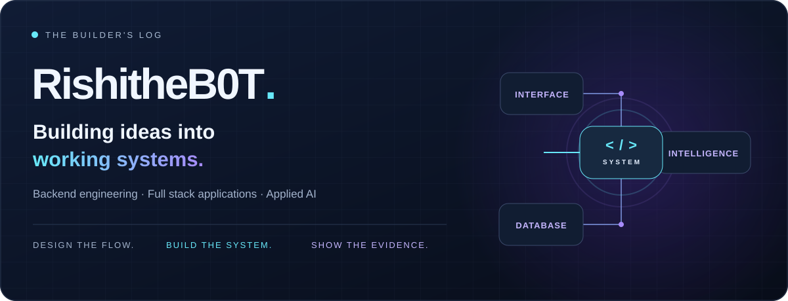
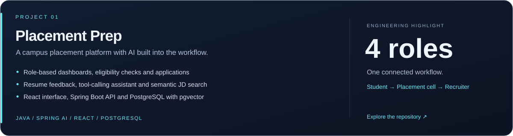
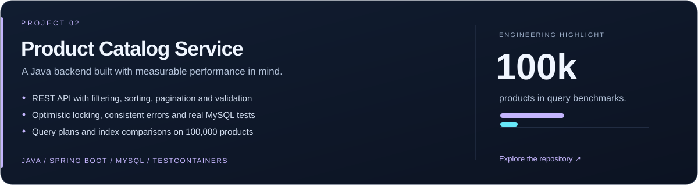

  

  <a href="https://github.com/RishitheB0T?tab=repositories"><b>Explore my work</b></a>
  &nbsp; · &nbsp;
  <a href="https://github.com/RishitheB0T/placement-prep"><b>Placement Prep</b></a>
  &nbsp; · &nbsp;
  <a href="https://github.com/RishitheB0T/product-catalog-service"><b>Product Catalog</b></a>

## Hey, I'm @RishitheB0T 👋

I build Java backends and full stack applications, with a focus on clear architecture, useful AI features, and evidence behind engineering decisions.

My projects connect the whole flow: the interface, the API, the database, and the rules that make them work together.

## Selected work

**Why explore it:** see how eligibility rules, authentication, application tracking, and AI tools fit into one application. Includes Docker Compose, backend integration tests, and frontend tests.

[Explore the project →](https://github.com/RishitheB0T/placement-prep) · [Read the architecture →](https://github.com/RishitheB0T/placement-prep#how-it-fits-together)

 

**Why explore it:** follow a backend from API design to real database tests and measured SQL optimization. The benchmark write-up includes improvements, regressions, and the trade-offs behind the indexes.

[Explore the project →](https://github.com/RishitheB0T/product-catalog-service) · [Read the performance evidence →](https://github.com/RishitheB0T/product-catalog-service/blob/main/docs/QUERY_OPTIMIZATION.md)

> The catalog is an active build. Redis caching, the React storefront, and deployment are planned; the repository tracks their progress.

## Tools I build with

## What you'll find in my repositories

- **Connected systems:** interfaces backed by real APIs and databases.
- **Business rules in code:** roles, eligibility, validation, and concurrent updates.
- **Tests that exercise behavior:** API flows, real database integration, and role-specific interfaces.
- **Decisions you can follow:** architecture diagrams, implementation notes, and reproducible performance evidence.

---

Design the flow. Build the system. Show the evidence.

